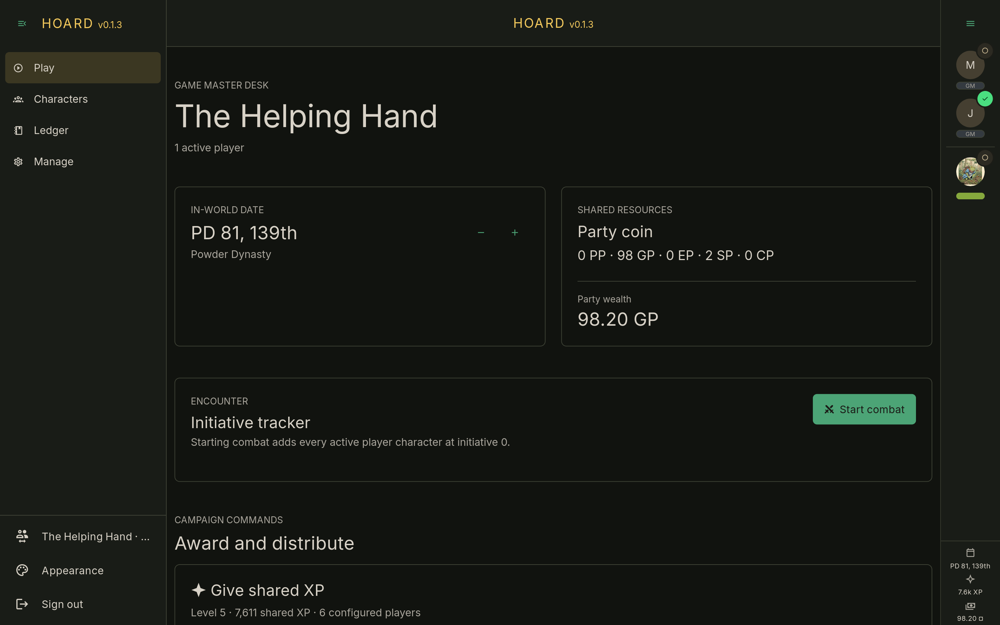
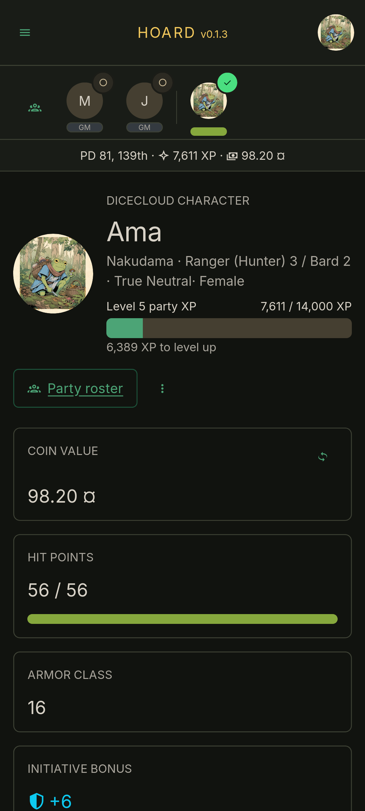

# Hoard

  

Hoard is a campaign companion for the everyday work of running a tabletop game.
It keeps the party's shared XP, calendar, roster, DiceCloud characters, and
campaign administration in one live, responsive workspace.

## Screenshots

### Desktop

The game-master dashboard keeps the party's progress, character details, and
campaign tools close at hand.

### Mobile

The same character information and campaign navigation adapt for smaller screens.

  

## Current release

Hoard `0.2.0` focuses on the shared campaign tools ready for regular play. Its
shared-XP workflow reflects one table's deliberately unusual approach to advancement:
the party earns and divides XP together, rather than tracking awards per character.

- shared XP, divided by the configured party size—including members without a
  DiceCloud sheet—with level progress and an immutable party ledger;
- a campaign calendar that records its date alongside ledger and audit events;
- read-only DiceCloud character sheets, with player and GM connection management;
- campaign membership, shareable invitations, roster management, and GM controls;
- live WebSocket updates in a responsive desktop and mobile interface.

DiceCloud remains the source of truth for character-sheet data. Hoard fetches public,
read-only creature data live and uses a short-lived outage fallback without keeping a
local copy of a character sheet.

## Contributing

See [CONTRIBUTING.md](CONTRIBUTING.md) for the local development environment,
verification commands, release-version workflow, deployment notes, and architecture.
